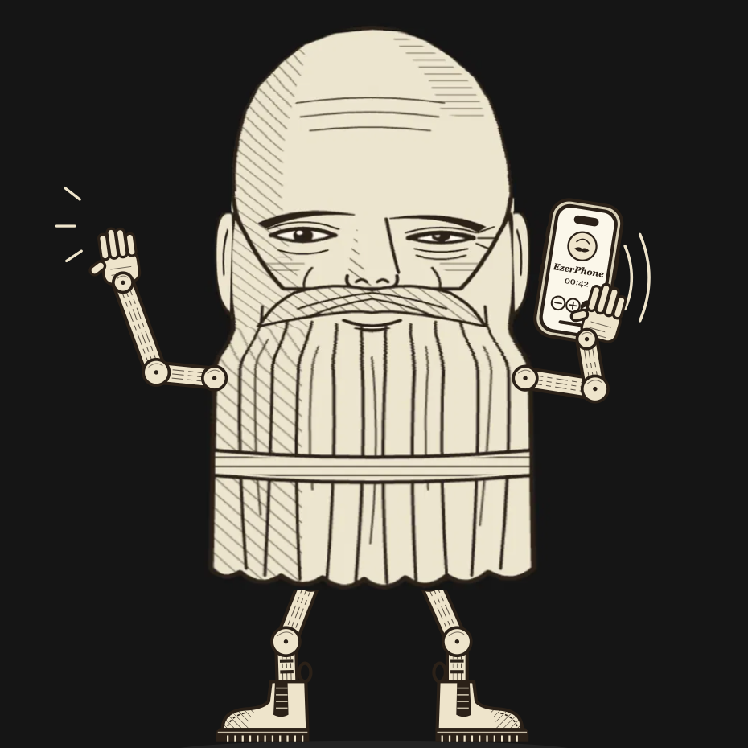

# EzerPhone

A hand-drawn SIP softphone for iPhone: sepia ink on parchment, built with SwiftUI on the
Linphone SDK and CallKit. Several accounts, per-account SRTP, an in-call keypad for voice
menus, and one-tap account setup from a link. Available in Russian, English, German,
Spanish, Hebrew, Arabic, Latvian, Lithuanian, Estonian, Chinese (Simplified), Korean and
Japanese, switchable in Settings.

Requires iOS 15 or later.

## Before you build

1. **Signing.** Open `sipphone.xcodeproj`, select the `sipphone` target, and under Signing &
   Capabilities pick your own team. Change the bundle identifier from `info.ezer.sipphone`
   to one of your own.
2. **Server.** `sipphone/Services/SecretsConfig.swift` holds a placeholder `serverBase`. It is
   the URL of the helper service that sits next to your PBX and offers `provision.php`
   (one-tap setup), `knock.php` (IP allow-listing before registration) and `logupload.php`
   (debug logs). Leave the log token empty to disable log upload. Without such a service the
   app still works: enter your SIP account by hand in Settings.
3. **Dependencies** come through Swift Package Manager (`linphone-sdk-swift-ios`) and resolve
   when the project is opened.

## Notes

- Push notifications for incoming calls need a paid Apple developer account (PushKit). Without
  it, iOS drops the SIP registration when the app goes to the background.
- The interface is built from its own small design system, `Views/InkStyle.swift` and
  `Views/InkGlyphs.swift`.
- `ezerphone://setup?t=<token>` is the URL scheme used for one-tap setup.
